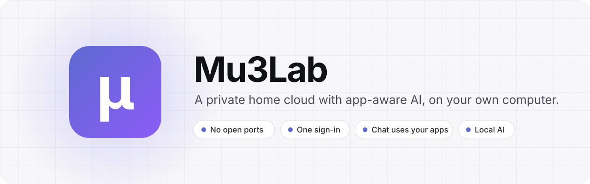
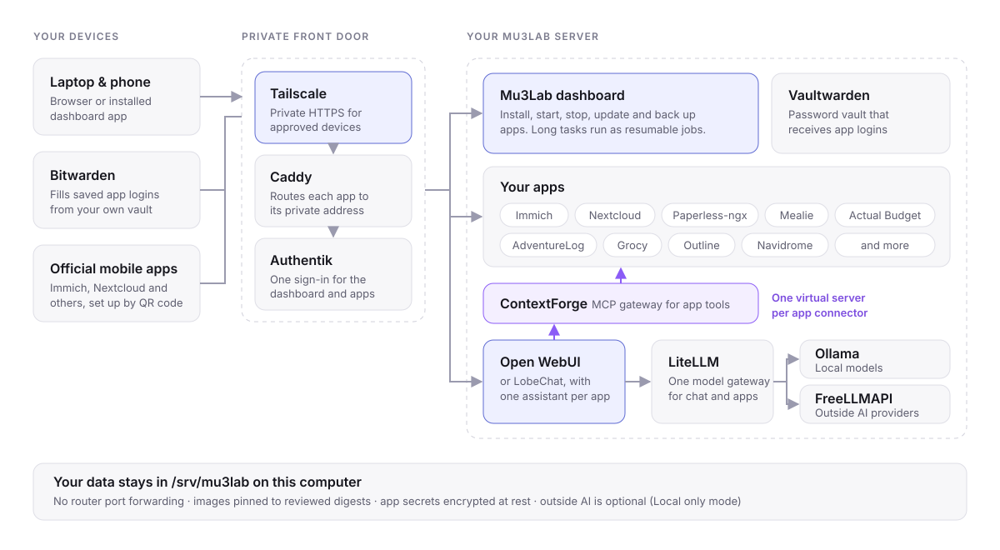
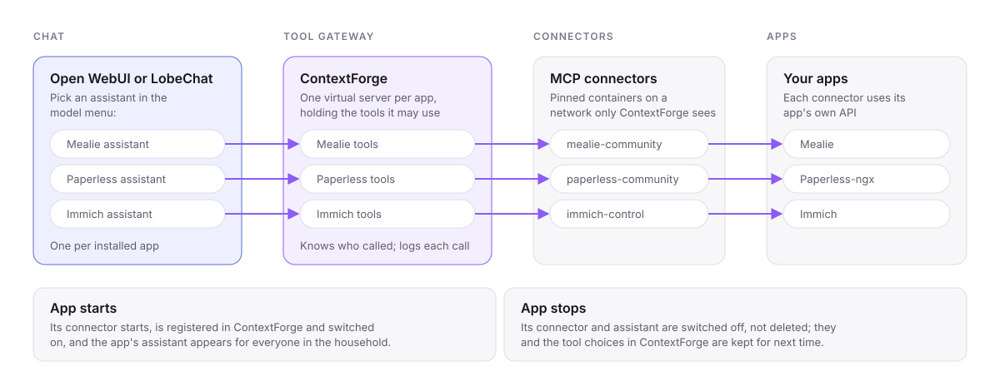
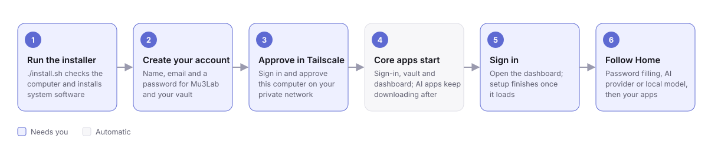

<p align="center">
  
</p>

# Mu3Lab

Mu3Lab turns a Linux computer into a private home cloud for your household. One installer sets up a curated set of self-hosted apps along with shared sign-in, a password vault, private remote access and AI chat that can work with your apps. A web dashboard lets you install, run, update and back up those apps without editing configuration files.

Mu3Lab handles deployment and the connections between apps. Each app still provides its own screens, data and features.

> [!NOTE]
> Mu3Lab is in active development. This README describes the code in this repository; fresh installs on every hardware and app combination have not all been tested. See [acceptance](docs/acceptance.md).

## Highlights

- **Private access.** Your devices connect through Tailscale with private HTTPS addresses. No router port forwarding is needed.
- **One sign-in.** Authentik signs people in to the dashboard and to apps that support it. Generated app logins are saved to your own Vaultwarden vault, ready for Bitwarden to fill.
- **Apps on demand.** Choose apps from the catalog, review download and disk estimates, and install. Start, stop, update, repair and remove them from the dashboard.
- **AI chat that knows your apps.** Open WebUI (default) or LobeChat, with one assistant per app. Use outside AI providers, local models through Ollama, or switch to **Local only**.
- **Household accounts.** Administrators and members, invitations and per-person app accounts.
- **Backups and recovery.** Optional scheduled, encrypted Kopia backups, automatic backups before app updates and guided app recovery.

## How it fits together

<p align="center">
  
</p>

Every request enters through Tailscale, then Caddy routes it to the right app behind Authentik. Two background services run the dashboard and its job worker; each app runs in its own Docker Compose project. All data lives under `/srv/mu3lab` on this computer.

## Applications

**Always installed:** Caddy (routing), Authentik (sign-in), Vaultwarden (passwords), Open WebUI (chat), ContextForge (app tools for chat), LiteLLM and FreeLLMAPI (AI routing) and Ollama (local models). Tailscale is installed on the host.

**Optional apps:**

| App | Purpose | Chat assistant |
| --- | --- | :---: |
| Immich | Photos and videos | ✓ |
| Nextcloud | Files, calendars and contacts | ✓ |
| Paperless-ngx | Searchable scanned paperwork | ✓ |
| Outline | Household wiki | ✓ |
| SurfSense | AI research workspace | ✓ |
| Mealie | Recipes and meal plans | ✓ |
| Grocy | Pantry and household stock | ✓ |
| Actual Budget | Budgeting | ✓ |
| Baby Buddy | Baby-care records | ✓ |
| Beaver Habits | Habit tracking | ✓ (off by default) |
| AdventureLog | Travel plans and journals | ✓ |
| Dawarich | Personal location history | ✓ (off by default) |
| Navidrome | Music streaming | |
| Audiobookshelf | Audiobooks and podcasts | |
| RomM | Game library with a browser player | |
| LobeChat | Alternative chat app | |
| Firecrawl | Web page extraction for AI | ✓ |
| Speech | Local speech recognition and spoken replies | |
| Kopia backups | Scheduled encrypted backups | |

Beaver Habits and Dawarich keep each person's data private, but chat assistants are shared by the household, so their assistants stay off until an administrator turns them on. The catalog is defined in [`apps/*/app.yaml`](apps). Proposals in `docs/expansion/` are ideas, not installable apps.

## AI chat and app tools

<p align="center">
  
</p>

Every new chat starts with the **Mu3Lab** assistant. It has no app tools, but it knows which app assistants are available and tells you which one to use. Each app with a chat connector gets its own assistant: pick it from the model menu, or type `@` and its name in the message box. The assistant reaches the app only through [ContextForge](https://github.com/IBM/mcp-context-forge), an MCP gateway where administrators choose each assistant's tools and review who called what. Starting an app switches its tools on; stopping it switches them off.

> [!IMPORTANT]
> Tools that change app data run **without a separate approval step**, and every household member gets the same assistants. A connector may use a shared app account, so it can reach more than one person's records. Turn off any tools you don't want in ContextForge.

AI answers come from outside providers (through FreeLLMAPI, allowed by default) or local models (through Ollama). **Local only** keeps Mu3Lab's chat requests on this computer. It does not stop web searches, downloads or other apps' own outside connections.

## Requirements

- An **x86-64** computer running Ubuntu 22.04+, Debian 12+ or a compatible derivative that the installer accepts. ARM, including Raspberry Pi, is not supported.
- A Linux account with `sudo` rights, an internet connection and a [Tailscale](https://tailscale.com) account.
- `git`, `curl`, `tar` and `sha256sum`.
- Enough memory and disk for the apps and content you choose. No single figure covers the whole catalog; the dashboard shows estimates before each install.
- Optional: an NVIDIA GPU with working drivers for faster local AI. AMD support varies by app.

## Install

<p align="center">
  
</p>

Run these as your normal user (not with `sudo`):

```bash
git clone https://github.com/dcazes/Mu3Lab.git
cd Mu3Lab
./install.sh
```

The installer asks for your computer password, your name, email and a new Mu3Lab password, then walks you through approving the computer in Tailscale. Setup finishes once you sign in and the dashboard loads; the AI apps keep downloading in the background. Home then guides you through password filling, AI and your first apps.

Keep the `Mu3Lab` folder where it is, because the background services run from it. Running `./install.sh` again checks and resumes setup; it does not download a newer version of Mu3Lab. The [user guide](docs/user-guide.md) covers every step in detail.

## Before you install

- **Docker and browsers.** Setup may install or upgrade Docker and restart it, which affects other containers on this computer. It also adds the Bitwarden extension to Chrome, Chromium and Brave through a browser policy, so those browsers may show *Managed by your organization*.
- **Backups stay local.** Scheduled backups need the Kopia backups app and are stored on this computer. Copying them elsewhere is up to you. Media libraries under `/srv/mu3lab/media` are not backed up.
- **Trusted household only.** The dashboard and worker share Docker access, which is equivalent to root on this computer. Mu3Lab is not designed to isolate untrusted users or apps.

## Updates and removal

Tagged installs can update Mu3Lab from **Settings → System → Mu3Lab updates**. Development checkouts update with `git pull` followed by `./install.sh`. App updates are offered separately and back up the app first.

To preview a full removal:

```bash
./uninstall.sh --dry-run
```

`./uninstall.sh` deletes `/srv/mu3lab`, **including local backups, saved passwords and media**. Copy anything you need first. Adding `--everything` also removes Docker (with any unrelated containers), Tailscale and NVIDIA container support.

## Documentation

| Document | What it covers |
| --- | --- |
| [User guide](docs/user-guide.md) | Preparation, every setup step, daily use, backups, recovery and removal, in plain language |
| [Technical deep dive](docs/architecture.md) | Installer, app contracts, networking, identity, jobs, AI, backups and updates, with links to the code |
| [Chat connectors](docs/chat-connectors.md) | How ContextForge, connectors and assistants work, and how to add a connector |
| [Backups and recovery](docs/backup-recovery.md) | What is backed up, schedules and restoring |
| [App updates](docs/app-updates.md) | How app versions are reviewed and applied |
| [Development](docs/development.md) | Working on Mu3Lab and running its checks |

Dated plans and reviews elsewhere in `docs/` record earlier designs and are not promises about current features.

## License

Mu3Lab is licensed under [AGPL-3.0-or-later](LICENSE). Included applications keep their own licenses.
